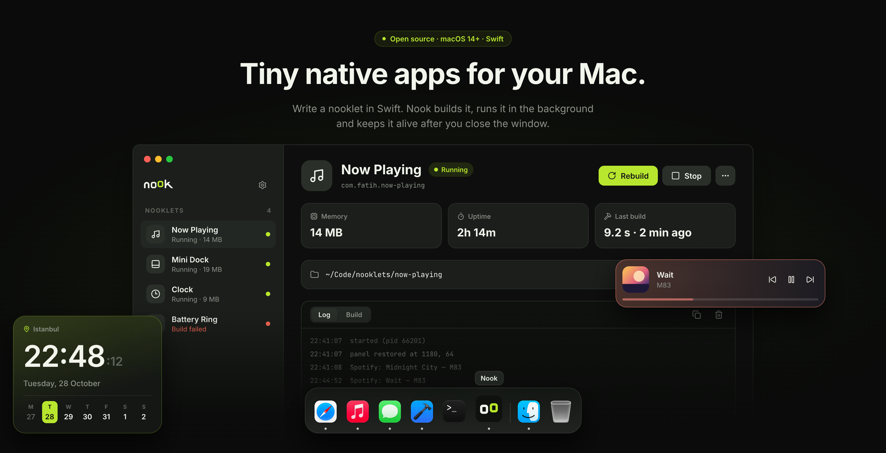

# Nook

Nook is a macOS-only manager for small native desktop apps called **nooklets**.

Build a clock, mini dock, now-playing panel, system monitor, timer, or any other always-visible tool as a normal Swift package. Nook builds and runs it as an independent process, so the nooklet keeps running even when the Nook manager window is closed.

> Nook gives developers the runtime plumbing. The interface and behaviour belong to the nooklet.

**Website:** [nook.fatihsen.dev](https://nook.fatihsen.dev)



## Why Nook?

- **Free-form UI** — build the interface with SwiftUI or AppKit.
- **Native performance** — nooklets are compiled native macOS executables.
- **Independent processes** — one nooklet crashing does not take down the others.
- **Manager-independent runtime** — running nooklets survive closing Nook.
- **Simple sharing** — a nooklet is a regular folder that can live in its own Git repository.
- **No per-nooklet setup** — create, add, build, run, stop and inspect nooklets from one app.

## Requirements

- macOS 14 or later
- Xcode or the Command Line Tools (Nook builds nooklets with the Swift 6 toolchain)

## Install

```bash
curl -fsSL https://nook.fatihsen.dev/install.sh | sh
```

The installer downloads the latest release, verifies its SHA-256 checksum and puts `Nook.app` in `~/Applications`. It also links the `nookctl` command-line tool into `~/.local/bin`. Set `NOOK_INSTALL_DIR` or `NOOK_BIN_DIR` to install somewhere else.

Prefer a manual install? Download [`Nook.dmg`](https://github.com/fatihsen-dev/nook/releases/latest/download/Nook.dmg) (or [`Nook.zip`](https://github.com/fatihsen-dev/nook/releases/latest/download/Nook.zip)) from the latest release and drag `Nook.app` into Applications. Releases are signed with a Developer ID and notarized by Apple, so they open without a Gatekeeper warning.

Nook checks for a new version when it opens and once a day, shows what changed and updates itself with one click; running nooklets keep running while it does. Check by hand with **Nook → Check for Updates…**. Updates are only installed when the download is signed with the same Developer ID as the running copy, so a copy built from source does not update itself.

## Run Nook from source

Clone the repository from GitHub and run the manager from the repository root:

```bash
git clone https://github.com/fatihsen-dev/nook.git
cd nook
NOOK_KIT_PACKAGE=$PWD swift run Nook
```

`NOOK_KIT_PACKAGE` points newly created nooklets at your local checkout of `NookKit`, so changes to the kit are picked up immediately. The installed app does not need it: it uses the GitHub repository.

## Create your first nooklet

1. Open Nook.
2. Choose **New nooklet**.
3. Enter a **Name** and an **Identifier**, and choose an empty folder.
4. Press **Create and run**. Nook writes a Swift package with a `nook.json` manifest and a starter entry file, builds it and starts it.

The generated structure looks like this:

```text
my-widget/
├── nook.json
├── Package.swift
├── .gitignore
└── Sources/
    └── app.swift
```

The entry file contains a type that conforms to `Nooklet`:

```swift
import NookKit
import SwiftUI

@main
struct MyWidget: Nooklet {
    var body: some NookScene {
        FloatingPanel {
            Text("My Widget")
                .font(.system(size: 24, weight: .semibold, design: .rounded))
                .padding(20)
                .background(.ultraThinMaterial, in: RoundedRectangle(cornerRadius: 16))
        }
    }
}
```

Nooklet code is intentionally unrestricted. You can use SwiftUI, AppKit, macOS notifications, AppleScript, Core Graphics, system frameworks, or your own dependencies.

## Add an existing nooklet

Use **Add existing folder** and choose a folder containing:

- `nook.json`
- `Package.swift`
- a Swift executable target that links `NookKit`

Nook validates the manifest, builds the package in release mode, installs the executable under its application support directory, and registers it with `launchd`.

## Command line and AI agents

`nookctl` does everything the Nook window does, from the terminal. It ships inside `Nook.app` (`Nook.app/Contents/MacOS/nookctl`; the installer links it into `~/.local/bin`):

```bash
nookctl new battery-ring --name "Battery Ring"   # create a nooklet and add it to the library
nookctl build .                                  # compile only; errors print as file:line:column: error: message
nookctl run .                                    # build, install and start (or restart)
nookctl logs . --follow                          # stream its log
nookctl list --json                              # status, pid and memory of every nooklet
```

A nooklet is referred to by its id or its folder. `build`, `run` and `list` take `--json`, and a failed build exits with status 1, so an AI coding agent can write a nooklet, build it, fix the reported errors and check the log on its own. The Nook window shows these changes within a few seconds. Run `nookctl help` for every command.

To teach an agent about Nook, give it the skill in [`skills/nook`](skills/nook/SKILL.md): it covers the nooklet layout, the NookKit API and this workflow, with compiling recipes. Copy the folder into your agent's skills directory (for Claude Code, `~/.claude/skills/nook`). The website also serves a summary for language models at [nook.fatihsen.dev/llms.txt](https://nook.fatihsen.dev/llms.txt).

## Nooklet lifecycle

Each nooklet runs as its own native process:

```text
Nook manager ── builds and registers ──▶ launchd ── runs and restarts ──▶ nooklet
```

Closing the Nook manager does not stop a running nooklet. `launchd` can start it at login and restart it after an unsuccessful exit.

Nook keeps its library, logs, build reports and installed binaries in `~/Library/Application Support/Nook/`. Logs are in `logs/<nooklet-id>.log`. Source folders are not modified when a nooklet is built, and removing a nooklet from Nook does not delete its source folder.

## NookKit

NookKit currently provides the common plumbing needed by nooklets:

- `Nooklet` — the entry point protocol
- `NookScene` — the scene abstraction
- `FloatingPanel` — a borderless panel the user can drag anywhere; Nook remembers where it was left
- `writeLog` — append a message to the nooklet's log, shown live in Nook's Log tab

`FloatingPanel` takes two optional arguments:

```swift
FloatingPanel(level: .floating, position: .topTrailing) {
    MyView()
}
```

| Argument | Values | Default |
|---|---|---|
| `level` | `.desktop` (below windows, on the desktop), `.normal`, `.floating` (above windows) | `.floating` |
| `position` | `.center`, `.top`, `.bottom`, `.topLeading`, `.topTrailing`, `.bottomLeading`, `.bottomTrailing` | `.center` |

Feature-specific services such as now-playing or battery data are intentionally out of scope for now: use native macOS APIs directly. The `examples/` directory and the [recipes on the website](https://nook.fatihsen.dev/#developers) (mini dock, now playing, battery, system stats, logging) show how.

## Examples

The repository includes three example nooklets:

| Example | Description |
|---|---|
| `clock` | A small desktop clock |
| `mini-dock` | A dock built from running applications |
| `now-playing` | A Spotify controller with artwork, progress and playback controls |

Examples are separate Swift packages. To build one:

```bash
cd examples/clock
swift build
```

To run an example directly during development:

```bash
NOOK_KIT_PACKAGE=../.. swift run
```

Normally, add the example folder to Nook and use the manager so it receives the same build, install, logging and launchd lifecycle as any other nooklet.

## Development

Build the manager:

```bash
swift build
```

Run the tests:

```bash
swift test
```

The structure of the repository and the role of each target are described in [docs/architecture.md](docs/architecture.md).

## Uninstall

1. In Nook, choose **Remove from Nook** for each nooklet. This stops it and removes its launchd agent; the source folders stay.
2. Quit Nook and delete `Nook.app` (from `~/Applications` if you used the installer), and `~/.local/bin/nookctl` if the installer linked it.
3. Delete Nook's data:

```bash
rm -rf "$HOME/Library/Application Support/Nook"
```

If you already deleted the app with nooklets still running, stop them from the terminal:

```bash
for agent in ~/Library/LaunchAgents/dev.nook.nooklet.*.plist; do
    launchctl bootout "gui/$(id -u)" "$agent"
    rm "$agent"
done
```

## Project status

Nook is an early project focused on the core nooklet workflow: create, add, build, run, inspect and manage small native desktop apps.

The API and manifest format may change before the first stable release.

## Contributing

Contributions are welcome. Before opening a pull request:

1. Keep changes focused.
2. Run `swift build`.
3. Run `swift test`.
4. Follow the structure and dependency rules in [docs/architecture.md](docs/architecture.md).
5. Do not add secrets or credentials to the repository.

## License

MIT. See [LICENSE](LICENSE).
